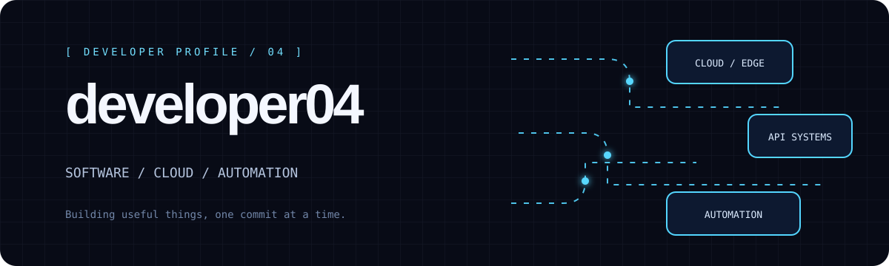

<!-- PROFILE README: developer04onserver -->

  
  <h1>DEVELOPER04</h1>
  
<strong>Software Engineering · Cloud & Edge · APIs · Automation · AI Experiments</strong>

  
<a href="https://github.com/developer04onserver?tab=repositories">ALL PROJECTS</a> · <a href="https://developer04-portfolio.developer04onserver.workers.dev/">PORTFOLIO</a> · <a href="https://github.com/developer04onserver">GITHUB PROFILE</a>

---

## About

I am Developer04, a developer focused on learning by building. I create practical software, experiment with cloud-native infrastructure, and explore tools that make development workflows simpler.

- Building APIs, backend services, and web applications
- Exploring serverless and edge computing with Cloudflare Workers
- Creating developer tools, automation, and integrations
- Experimenting with AI application patterns and data workflows
- Interested in reliable, secure, maintainable software

## Technology map

The icons below are a broad map of technologies I work with, explore, or want to build with. They are not a claim of equal proficiency across every tool.

### Programming languages and web foundations

### Frontend, UI and design

### Backend, APIs and runtimes

### Databases, storage and messaging

### Cloud, edge and infrastructure

### AI, data and machine learning

### Developer tools, testing and collaboration

## Areas of exploration

| Area | Topics |
|---|---|
| Software engineering | Architecture, clean code, testing, debugging, design patterns |
| Web development | Responsive UI, accessibility, browser APIs, performance |
| Backend engineering | REST, GraphQL, authentication, authorization, caching |
| Cloud and edge | Workers, serverless, object storage, distributed systems |
| Data | SQL, NoSQL, indexing, queues, ETL, data validation |
| AI applications | LLM APIs, prompt design, RAG, embeddings, evaluation |
| DevOps | CI/CD, containers, observability, infrastructure as code |
| Security | Secure configuration, input validation, secrets hygiene, threat awareness |
| Creative coding | SVG animation, Canvas, WebGL, Three.js, interactive experiences |

## Project collections

Explore the public [repository collection](https://github.com/developer04onserver?tab=repositories). Projects cover API engineering, data tooling, automation, Cloudflare edge computing, frontend interfaces, AI experiments, and backend utilities.

## GitHub activity

  
  
  

## Principles

- Build useful things, not just demos
- Prefer clarity over unnecessary complexity
- Keep security and accessibility in the workflow
- Document setup, decisions, and limitations
- Learn in public and improve through iteration

Built with curiosity. Maintained by Developer04.

